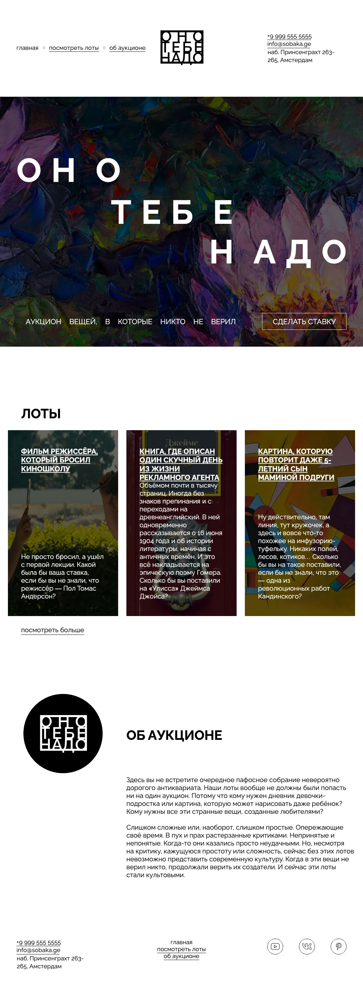
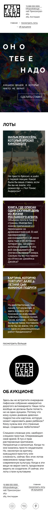

# Ono Tebe Nado — Auction Landing Page

A responsive landing page for **«Оно тебе надо»** (roughly, “Do you really need it?”), an auction of unconventional objects that became cultural icons. Built from a Figma design with semantic HTML5 and vanilla CSS3, the page combines expressive typography, full-bleed imagery, and an editorial card layout.

The website content is in Russian; this documentation is in English.

- **Live website:** https://freakperry.github.io/ono-tebe-nado/
- **Repository:** https://github.com/FreakPerry/ono-tebe-nado

## Technologies

- **HTML5** — semantic sections, navigation, articles, and contact information.
- **CSS3** — Grid, Flexbox, media queries, custom fonts, and responsive typography.
- **Raleway** — locally hosted Regular and Bold fonts.

No JavaScript, frameworks, package manager, or build step is required.

## Features

- Desktop layout based on the 1100 px Figma frame.
- Floral hero with a three-line headline and a contact call to action.
- Three illustrated auction lots and an about section.
- Responsive layout with stacked navigation, cards, and content below 900 px.
- Additional spacing and typography adjustments for narrow mobile screens.
- Accessible landmarks, image descriptions, visible keyboard focus, and reduced-motion support.
- Local image, SVG, and font assets; no temporary Figma URLs or external font requests.

The navigation links jump to page sections. The bid button opens an email draft rather than submitting a bid. Social links lead to the respective platforms because specific profile URLs were not supplied.

## Screenshots

### Desktop



### Mobile



## Installation and local usage

1. Clone this repository, or download and extract its ZIP archive:

   ```sh
   git clone https://github.com/FreakPerry/ono-tebe-nado.git
   cd ono-tebe-nado
   ```
2. Open a terminal in the project directory.
3. Start a local web server with Python 3:

   ```sh
   python3 -m http.server 8000 --bind 127.0.0.1
   ```

4. Visit **http://127.0.0.1:8000** in your browser.

Stop the server with `Ctrl+C`. Python is only a convenience for serving the files locally; it is not a website dependency. You can also open `index.html` directly in a modern browser.

## Project structure

```text
.
├── index.html             # Landing page
├── styles/
│   ├── global.css         # Reset, typography, and global styles
│   └── style.css          # Components and responsive layout
├── fonts/
│   ├── fonts.css          # Local @font-face declarations
│   └── Raleway-*.woff2    # Font files
├── assets/                # Original images and SVG assets
├── docs/                  # Desktop and mobile screenshots
├── .gitignore
├── .nojekyll              # Serve plain static files on GitHub Pages
└── README.md
```

## GitHub Pages

This project can be served directly from the repository root without a build process. In **Settings → Pages**, choose **Deploy from a branch**, select **main** and **/ (root)**, and save. GitHub displays the live URL when the deployment is ready.

All stylesheet, image, and font references use relative paths, so the site also works under a GitHub Pages project subpath.

## Verification

The local page was visually compared with the Figma reference. Browser checks at 320, 390, 768, and 1100 px confirmed that image assets load and the page has no horizontal overflow. Local HTML and CSS file references were checked after reorganizing the styles and fonts.

## Design and credits

- [Figma design reference](https://www.figma.com/design/6WKU5qH1c2qiC1RaLHWpEC/?node-id=1-2).
- Images and SVGs are supplied by the design.
- The film image retains its original credit: courtesy of Metro Goldwyn Mayer Pictures Inc.; © 2021 Metro-Goldwyn-Mayer Pictures Inc. All rights reserved.
- Raleway font files originate from the [Yandex Practicum starter project](https://github.com/yandex-praktikum/ono-tebe-nado/tree/main/fonts). The required [SIL Open Font License](fonts/OFL.txt) accompanies the font files.
